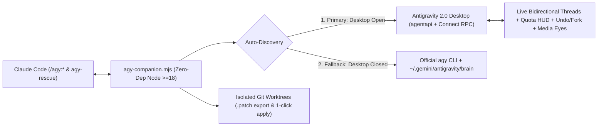

<div align="center">

# `claude-antigravity` (`/agy:*`)

**The Bidirectional Live IDE Bridge, Multimodal Eyes & Parallel Worktree Engine between Claude Code and Google Antigravity 2.0**

*Teleport entire conversations live in both directions, give Claude Code native video & audio perception via Gemini, race solutions in isolated git worktrees, critique plans before coding, and monitor live model quotas — with zero npm dependencies.*

[](https://github.com/JoseAQ-19/claude-antigravity/actions/workflows/ci.yml)
[](LICENSE)
[](https://claude.com/claude-code)
[](https://antigravity.google/)
[](#-platform--security-guarantees)
[](package.json)

[Why `claude-antigravity`](#-why-claude-antigravity) • [30-Second Install](#-30-second-install) • [7 Killer Superpowers](#-the-7-superpowers) • [All 16 Commands](#-complete-command-reference) • [Architecture](#-dual-engine-architecture) • [Guía en Español](#-guía-completa-en-español)

</div>

---

## 💡 Why `claude-antigravity`?

OpenAI built [`openai/codex-plugin-cc`](https://github.com/openai/codex-plugin-cc) (34.5k+ ⭐) so Claude Code can collaborate with Codex — yet **Google has not released an official Claude Code plugin for Antigravity**.

Even worse, **solo Claude Code has structural blind spots**, and **100% of existing community wrappers only shell out to `agy -p` over Bash**:
1. **Claude Code is blind to video & deaf to audio:** You cannot hand Claude a `.mp4` screen recording of a flickering UI bug or a `.mp3` meeting recording without setting up `ffmpeg` + Whisper locally.
2. **CLI-only wrappers fail for Antigravity Desktop IDE users:** Most developers install the visual **Google Antigravity 2.0 Desktop IDE** without installing the separate `agy` CLI — causing every `agy -p` wrapper on GitHub to fail on step 1.
3. **Siloed conversations:** Moving from Claude Code to Antigravity (or from Antigravity back to Claude Code) normally forces you to re-explain your entire architecture from scratch.
4. **File collisions & Windows hangs:** Background CLI agents overwrite files Claude is actively editing, and `agy -p` over Bash notoriously hangs on native Windows (`ConPTY 0-byte log`).

**`claude-antigravity` solves all four natively:**

| Capability | Solo Claude Code | `agy -p` Bash Wrappers | OAuth API Proxies | **`claude-antigravity`** |
| :--- | :---: | :---: | :---: | :---: |
| **Works with Antigravity 2.0 Desktop IDE *(no `agy` CLI install needed)*** | — | ❌ Fails | ⚠️ Token scrape | ✅ **Auto-discovers live Desktop RPC + `agentapi`** |
| **Live Session Teleport (`Claude → Antigravity` + auto-executes next step)** | — | ❌ None | ❌ None | ✅ **`/agy:transfer` (opens & focuses in IDE)** |
| **Reverse Live Teleport (`Antigravity → Claude Code`)** | — | ❌ None | ❌ None | ✅ **`/agy:pull` (live RPC + offline brain logs)** |
| **Multimodal Video (`.mp4`/`.mov`) & Audio (`.mp3`/`.wav`) Eyes** | ❌ Blind | ⚠️ Rare / CLI-only | ❌ None | ✅ **`/agy:media` + `file:line` code correlation** |
| **Zero-Collision Parallel `git worktree` & Agent Racing** | Manual | ❌ Overwrites files | — | ✅ **`--worktree` & `/agy:race`** |
| **Live Per-Model Quota Bars & Reset Countdown HUD** | — | ❌ None | External GUI | ✅ **`/agy:quota` inside Claude Code** |
| **Time-Travel Rollback (`RevertToCascadeStep`) & Branching (`Fork`)** | — | ❌ None | ❌ None | ✅ **`/agy:undo` & `/agy:fork`** |
| **Native Windows + macOS (Apple Silicon & Intel) + Linux** | ✅ | ❌ ConPTY hangs | Varies | ✅ **Zero-Dep Node `>= 18` ESM (0 PTY hangs)** |
| **100% ToS-Safe (Zero OAuth / Keyring Token Scraping)** | ✅ | ✅ | ❌ **Ban risk** | ✅ **Uses only your official local app/CLI** |

---

## ⚡ 30-Second Install

### Prerequisites
Have **either** of the following on your machine:
1. **[Google Antigravity 2.0 Desktop IDE](https://antigravity.google/)** open *(zero CLI installation required — auto-discovered live!)*, **OR**
2. **[Antigravity CLI (`agy`)](https://antigravity.google/docs/cli/getting-started)** installed and authenticated (`agy auth`).

### Option 1 — Native Claude Code Plugin *(Recommended)*
Run these three slash commands inside **Claude Code**:

```text
/plugin marketplace add JoseAQ-19/claude-antigravity
/plugin install agy@claude-antigravity
/reload-plugins
```

Verify your active engine (`desktop-live` or `cli-headless`) and live model quotas:

```text
/agy:setup
/agy:quota
```

### Option 2 — Universal Agent Skills Registry (`skills.sh`)
```bash
npx skills add JoseAQ-19/claude-antigravity
```

---

## 🚀 The 7 Superpowers

### 1. 🔄 Bidirectional Live Session Teleport (`/agy:transfer` & `/agy:pull`)
Move an entire working session between **Claude Code** and **Antigravity 2.0 Desktop** in either direction without losing a single architectural decision:
- **`/agy:transfer [instruction]`**: Parses your active Claude `.jsonl` transcript, strips multi-megabyte tool dumps, saves the verbatim archive to `.claude/agy-handoffs/`, opens and visually focuses (`SmartFocusConversation`) the new thread in **Antigravity 2.0 Desktop**, **and immediately executes the next pending step**.
- **`/agy:pull [conversation-id]`**: Queries Antigravity's live trajectory (`GetAllCascadeTrajectories` + `GetCascadeTrajectory` + `GetTrajectoryFileDiffs`, with automatic offline fallback to `~/.gemini/antigravity/brain`) and imports Antigravity's work straight into your active Claude Code terminal.

```text
/agy:transfer "Finish implementing the Stripe webhook tests we just designed"
/agy:pull --list
/agy:pull
```

### 2. 🎥 Multimodal Video & Audio "Eyes" for Claude (`/agy:media`)
Claude Code cannot watch screen recordings or listen to audio — **Gemini inside Antigravity is natively multimodal**. Record a 15-second `.mp4`/`.mov` video of a broken UI animation, layout shift, or console race condition:
1. Antigravity ingests the video/audio/PDF directly via its native multimodal reader.
2. Writes the full exhaustive timestamped transcript to `.claude/agy-handoffs/media-*.md` **(so a 1-hour video never pollutes Claude's context window)**.
3. Correlates what happens at each `MM:SS` timestamp with your repository's source code and hands Claude the exact `file:line` diagnosis + recommended fix.

```text
/agy:media ./recordings/modal-flicker.mp4 "Why does the backdrop flash white when closing?"
/agy:media ~/Downloads/client-feedback.mp3 "Extract every UI change requested and map each to our React components"
```

### 3. 🌿 Zero-Collision Parallel Git Worktrees & Agent Racing (`--worktree` & `/agy:race`)
Never let a background sub-agent overwrite files you are actively editing in Claude Code:
- **`/agy:rescue --worktree "<task>"`**: Spins up a clean detached `git worktree`, runs Antigravity in complete isolation, captures **both modified and newly created untracked files** into `.claude/agy-handoffs/worktree-<id>.patch`, cleans up the temp directory, and lets you merge in one command (`/agy:result <id> --apply-worktree`).
- **`/agy:race "<hard bug or refactor>"`**: Dispatches Antigravity in a background `--worktree` while Claude Code solves the exact same task concurrently in your workspace, then presents a side-by-side comparison of both diffs so you keep the winner.

```text
/agy:rescue --background --worktree "Migrate src/db/queries.ts from raw SQL to prepared statements"
/agy:result task-abc123 --apply-worktree

/agy:race "Fix the race condition in WebSocket reconnection without adding external dependencies"
```

### 4. 📐 Pre-Implementation Architecture & YAGNI Plan Critique (`/agy:review-plan`)
Stop burning thousands of tokens implementing flawed plans. Automatically detects your latest plan from **Claude Plan Mode** (`~/.claude/plans/*.md`), `PLAN.md`, `PRD.md`, or your active session, and runs an independent Principal Architect & YAGNI critique (`READY TO IMPLEMENT` vs `REVISE PLAN FIRST`) before a single file is edited.

```text
/agy:review-plan
/agy:review-plan docs/migration-plan.md "Check multi-tenant auth boundaries and rollback safety"
```

### 5. 📊 Live Per-Model Quota Bars & Reset Countdown HUD (`/agy:quota`)
Query Antigravity 2.0 Desktop's live `GetCascadeModelConfigData` and `GetUserStatus` endpoints directly from Claude Code — showing visual ASCII quota bars (`█████████░░░ 75.0%`), exact reset timers (`2h 15m`), multimodal support, and active background jobs *(account email redacted by default for screenshot safety)*.

```text
/agy:quota
```

### 6. ⏪ Time-Travel Rollback & Conversation Forking (`/agy:undo` & `/agy:fork`)
Control Antigravity trajectories directly via Desktop RPC:
- **`/agy:undo [--apply]`**: Previews (`GetRevertPreview`) by default or rolls back (`RevertToCascadeStep` + git fallback) the last delegated Antigravity turn.
- **`/agy:fork [--step <n>]`**: Branches an Antigravity conversation (`ForkConversation`) so you can test an alternative hypothesis without losing the original thread.

```text
/agy:undo
/agy:undo --apply
/agy:fork
```

### 7. 🧠 Non-Destructive Cross-Agent Memory Sync (`/agy:sync-memory`)
Keep `CLAUDE.md` and Antigravity's `AGENTS.md` + `.agents/rules/claude-memory-sync.md` (`trigger: always_on`) synchronized using managed HTML comment blocks and automatic `.bak` backups — dry-run preview by default, zero destructive overwrites.

```text
/agy:sync-memory
/agy:sync-memory --apply
```

---

## 🧩 Complete Command Reference (All 16 `/agy:*` Commands)

| Category | Command | Purpose |
| :--- | :--- | :--- |
| **Session Teleport** | `/agy:transfer [instruction]` | Teleport active Claude `.jsonl` session live into Antigravity 2.0 IDE + auto-execute next step (`--handoff-only`, `--no-focus`, `--background`). |
| **Session Teleport** | `/agy:pull [id]` | Pull an active/recent Antigravity 2.0 conversation and touched files live into Claude Code (`--list`, `--all`). |
| **Multimodal Eyes** | `/agy:media <files...> [question]` | Analyze `.mp4`/`.mov` videos, `.mp3`/`.wav` audio, PDFs, or images via Gemini + correlate bugs to `file:line` (`--no-correlate`). |
| **Delegation & Race** | `/agy:rescue [task]` | Delegate tasks via `agy:agy-rescue` subagent (`--background`, `--worktree`, `--resume`, `--fresh`, `--focus-ui`, `--model pro\|flash\|flash_lite`). |
| **Delegation & Race** | `/agy:race <task>` | Race Antigravity (in isolated `--worktree`) vs Claude Code concurrently and compare both diffs side-by-side. |
| **Reviews & Plans** | `/agy:review-plan [file] [focus]` | Critique Claude Plan Mode / `PLAN.md` / `PRD.md` for architectural blind spots & YAGNI before coding. |
| **Reviews & Plans** | `/agy:review` | Independent read-only code review of uncommitted changes or branch diffs (`--scope`, `--base`). |
| **Reviews & Plans** | `/agy:adversarial-review [focus]` | Red-team adversarial review challenging edge cases, race conditions, and security boundaries. |
| **HUD & Time-Travel** | `/agy:quota` | Live HUD of Antigravity model availability, quota bars, reset countdowns, and active jobs (`--show-account`). |
| **HUD & Time-Travel** | `/agy:undo [job-id]` | Dry-run preview or `--apply` rollback of the latest Antigravity turn (`RevertToCascadeStep` + git fallback). |
| **HUD & Time-Travel** | `/agy:fork [id]` | Branch an Antigravity conversation at the current or `--step <n>` index (`ForkConversation`). |
| **Memory & Ops** | `/agy:sync-memory` | Preview or `--apply` bidirectional rules sync (`CLAUDE.md` ↔ `AGENTS.md` + `.agents/rules/`). |
| **Memory & Ops** | `/agy:setup` | Engine health check + toggle session-end review gate (`--enable-review-gate` / `--disable-review-gate`). |
| **Memory & Ops** | `/agy:status [job-id]` | Show active/recent jobs (`--wait`, `--all`). |
| **Memory & Ops** | `/agy:result [job-id]` | Show full output of a finished job or merge its isolated worktree patch (`--apply-worktree`). |
| **Memory & Ops** | `/agy:cancel [job-id]` | Cancel a running background job and stop its live Antigravity cascade invocation. |

---

## 🏗️ Dual-Engine Architecture



- **Cross-Platform Process Discovery (`ls-discovery.mjs`):** Automatically discovers `language_server` across **Windows** (PowerShell CIM/TCP), **macOS Apple Silicon & Intel** (`Antigravity.app` / `language_server_macos_arm` via `ps -axww` + `lsof` + `/private` symlink normalization), and **Linux** (`ps` + `lsof` / `ss -tlnp`), probing IPv4 `127.0.0.1` first to avoid IPv6 `::1` loopback delays.
- **Future-Proof RPC Resilience (`agy-runtime.mjs`):** Optional internal Connect RPC calls gracefully fall back to `agentapi`, git diffing, or offline brain logs if an endpoint changes in a future Antigravity Desktop release.

---

## 🔒 Platform & Security Guarantees

- **Zero OAuth / Keyring Scraping (100% ToS-Safe):** Never reads, extracts, or proxies OAuth tokens, cookies, or API keys. Every action executes strictly through your local official Antigravity 2.0 Desktop app or `agy` CLI. See [SECURITY.md](SECURITY.md).
- **Zero `npm` Runtime Dependencies:** Pure Node.js `>= 18` built-in modules (`0` third-party supply-chain packages).
- **Featherlight Context Budget:** Concise command frontmatter keeps always-on session overhead minimal while storing heavy transcripts and video breakdowns on disk inside gitignored `.claude/agy-handoffs/`.

---

<details>
<summary><b>🇪🇸 Guía Completa en Español (Instalación y los 7 Superpoderes)</b></summary>

### ¿Por qué usar `claude-antigravity`?
1. **Le da "ojos y oídos" a Claude Code (`/agy:media`):** Claude no puede ver vídeos `.mp4`/`.mov` de bugs visuales ni escuchar audios `.mp3`. Con `/agy:media`, Gemini en Antigravity analiza el vídeo fotograma a fotograma, guarda el desglose completo en disco para no gastar contexto de Claude y le devuelve la causa raíz exacta (`archivo:línea`).
2. **Teletransporte Bidireccional en Vivo (`/agy:transfer` y `/agy:pull`):** Pasa tu conversación entera de Claude a la ventana visual de **Antigravity 2.0 Desktop** ejecutando automáticamente el siguiente paso (`/agy:transfer`), o tráete de vuelta cualquier conversación de Antigravity hacia Claude Code (`/agy:pull`).
3. **Funciona sin instalar `agy` CLI y sin cuelgues en Windows/Mac:** Autodescubre Antigravity 2.0 Desktop en Windows, macOS (M1–M4 e Intel) y Linux, usando `agy` CLI automáticamente como respaldo.
4. **Cero colisiones de archivos (`--worktree` y `/agy:race`):** Aísla a Antigravity en un `git worktree` limpio o pon a competir a Claude y Antigravity en paralelo sobre el mismo bug.
5. **Crítica de Planes (`/agy:review-plan`), HUD de Cuotas en Vivo (`/agy:quota`), Control del Tiempo (`/agy:undo` y `/agy:fork`) y Memoria Compartida (`/agy:sync-memory`).**

### Instalación en 30 Segundos (Dentro de Claude Code)
```text
/plugin marketplace add JoseAQ-19/claude-antigravity
/plugin install agy@claude-antigravity
/reload-plugins
```

### Ejemplos Rápidos
```text
/agy:setup                                      # Verifica conexión Desktop/CLI
/agy:quota                                      # Barras de cuota y reinicio por modelo en vivo
/agy:media grabacion-bug.mp4 "¿Por qué falla?"  # Analiza vídeo + localiza el bug en tu código
/agy:review-plan                                # Audita tu plan antes de picar código
/agy:race "Optimiza el parser sin romper tests" # Competición en paralelo (worktree aislado)
/agy:transfer                                   # Teletransporta tu chat a Antigravity y ejecuta el siguiente paso
/agy:pull                                       # Importa la conversación de Antigravity a Claude Code
/agy:undo --apply                               # Revierte el último turno delegado
/agy:sync-memory --apply                        # Sincroniza CLAUDE.md <-> AGENTS.md con backup
```

</details>

---

## 🛠️ Local Development & Verification

```bash
# 1. Run release audit (16 commands, zero personal paths, manifest sync) + hermetic CI tests
npm run verify

# 2. Run live round-trip E2E test against running Antigravity 2.0 Desktop
npm run test:live

# 3. Validate Claude Code plugin manifest locally
claude plugin validate .
```

See [CONTRIBUTING.md](CONTRIBUTING.md) and [CHANGELOG.md](CHANGELOG.md).

---

## ⚖️ License & Disclaimer

Licensed under the **[Apache License 2.0](LICENSE)** — Copyright © 2026 [Jose Ariza Quintero (@JoseAQ-19)](https://github.com/JoseAQ-19). See [NOTICE](NOTICE) for architectural attributions.

> **Disclaimer:** Independent open-source community project. **Not affiliated with, endorsed by, sponsored by, or supported by Google LLC or Anthropic PBC.** "Google", "Antigravity", and "Gemini" are trademarks of Google LLC. "Claude" and "Claude Code" are trademarks of Anthropic PBC.
