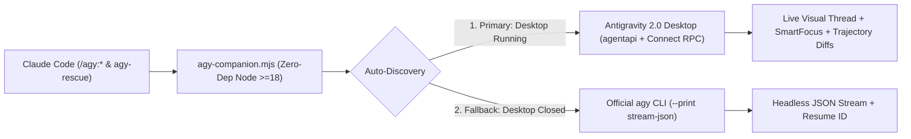

<div align="center">

# `claude-antigravity-bridge` (`/agy:*`)

**Live Google Antigravity 2.0 Desktop IDE + `agy` CLI Companion Plugin for Claude Code**

*Transfer entire active Claude Code conversations live into Antigravity 2.0 Desktop, delegate heavy tasks in the background, and run cross-model code reviews — with zero runtime dependencies.*

[](https://github.com/JoseAQ-19/claude-antigravity-bridge/actions/workflows/ci.yml)
[](LICENSE)
[](https://claude.com/claude-code)
[](https://antigravity.google/)
[](#platform--security-guarantees)
[](package.json)

[Why This Exists](#-why-this-exists) • [Install](#-30-second-install) • [Commands](#-slash-commands) • [Architecture](#-dual-engine-architecture) • [Guía en Español](#-guía-rápida-en-español)

</div>

---

## 💡 Why This Exists

OpenAI released [`openai/codex-plugin-cc`](https://github.com/openai/codex-plugin-cc) so Claude Code users can delegate tasks and sessions to Codex, while **Google has not released an official Claude Code plugin for Antigravity**.

Existing community wrappers shell out exclusively to `agy -p` over Bash — which breaks in three critical scenarios that **`claude-antigravity-bridge`** solves natively:

| Capability | CLI-Only Wrappers (`agy -p`) | **`claude-antigravity-bridge`** |
| :--- | :---: | :---: |
| **Works with Antigravity 2.0 Desktop IDE (without installing `agy` CLI)** | ❌ Fails on step 1 | ✅ **Auto-discovers live Desktop `language_server` + `agentapi`** |
| **Live `.jsonl` Conversation Transfer (`/agy:transfer`)** | ❌ None *(or terminal-only restart)* | ✅ **Opens & focuses thread live in Antigravity 2.0 IDE + executes next step** |
| **Native Windows Support (PowerShell / CMD)** | ⚠️ Hangs on `ConPTY` (`0-byte log`) | ✅ **100% pure Node.js ESM + HTTP Connect RPC (zero PTY hangs)** |
| **Headless / Server Fallback (`agy` CLI)** | ✅ Yes | ✅ **Automatic Dual-Mode fallback (`cli-headless`)** |
| **Account Safety (ToS Compliance)** | ✅ CLI auth | ✅ **Zero OAuth scraping — uses only your official local app/CLI** |

---

## ⚡ 30-Second Install

### Prerequisites
Have **either** of the following on your machine:
1. **[Google Antigravity 2.0 Desktop IDE](https://antigravity.google/)** open *(zero extra CLI installation required!)*, **OR**
2. **[Antigravity CLI (`agy`)](https://antigravity.google/docs/cli/getting-started)** installed and authenticated (`agy auth`).

### Option A — Native Claude Code Plugin *(Recommended)*
Run these three commands inside **Claude Code**:

```text
/plugin marketplace add JoseAQ-19/claude-antigravity-bridge
/plugin install agy@antigravity-live
/reload-plugins
```

Verify your active engine (`desktop-live` or `cli-headless`):

```text
/agy:setup
```

### Option B — Agent Skills Registry (`skills.sh`)
If you also want the standalone universal skill across Agent Skills-compatible tools:

```bash
npx skills add JoseAQ-19/claude-antigravity-bridge
```

---

## 🧩 Slash Commands

| Command | What It Does |
| :--- | :--- |
| **`/agy:transfer [instruction]`** | **Live Conversation Handoff:** Captures your active Claude Code `.jsonl` session, strips tool/telemetry bloat, saves the full verbatim archive in `.claude/agy-handoffs/`, opens and visually focuses the new conversation inside **Antigravity 2.0 Desktop**, **and automatically executes the next pending step**. Pass `--handoff-only` to transfer context without executing, `--no-focus` to stay in terminal, or `--background` to detach. |
| **`/agy:rescue [task]`** | **Task Delegation:** Hand off complex debugging, UI/frontend implementation, deep research, or refactors to Antigravity (`--wait`, `--background`, `--resume`, `--fresh`, `--focus-ui`, `--model pro\|flash\|flash_lite`). Also available proactively via the `agy:agy-rescue` subagent. |
| **`/agy:review`** | **Code Review:** Independent read-only review of uncommitted changes (`--scope working-tree`), current branch (`--scope branch`), or against a base branch (`--base main`). |
| **`/agy:adversarial-review [focus]`** | **Adversarial Review:** Red-team style review challenging design assumptions, race conditions, auth boundaries, and failure modes before shipping. |
| **`/agy:status [job-id]`** | Inspect active and recent foreground/background Antigravity jobs for the current workspace (`--wait`, `--all`). |
| **`/agy:result [job-id]`** | Render the final answer, reasoning summary, touched files, and `agy --conversation <id>` resume command of a completed job. |
| **`/agy:cancel [job-id]`** | Cancel an active job (`CancelCascadeInvocation` / `ForceStopCascadeTree` on Desktop + local worker termination). |
| **`/agy:setup`** | Health check for Antigravity 2.0 Desktop + `agy` CLI and toggle the optional session-end review gate (`--enable-review-gate` / `--disable-review-gate`). |

### Common Workflows

```text
# 1. Hit Claude token limits or want Gemini/Antigravity IDE to take over your current chat live:
/agy:transfer

# 2. Transfer the whole Claude conversation with a specific next-step directive:
/agy:transfer "Implement the Playwright tests we just designed and fix any failing selectors"

# 3. Delegate a heavy background investigation while you keep coding in Claude Code:
/agy:rescue --background --model flash "Audit all API routes for missing rate-limiting"

# 4. Continue the most recent Antigravity conversation (including a transferred one):
/agy:rescue --resume "Now add unit tests for the edge cases you found"

# 5. Challenge your branch diff before opening a PR:
/agy:adversarial-review --base main "focus on SQL injection and tenant isolation"
```

---

## 🏗️ Dual-Engine Architecture



1. **Zero-Config Desktop Discovery (`ls-discovery.mjs`):** Automatically locates the active Antigravity 2.0 `language_server` process on Windows (`Get-CimInstance` + `Get-NetTCPConnection`), macOS (`ps` + `lsof`), and Linux (`ps` + `lsof` / `ss -tlnp`), verifying `Heartbeat` over localhost before dispatching.
2. **Lossless `.jsonl` Session Compiler (`claude-session-parser.mjs`):** Locates your active `~/.claude/projects/<workspace>/<session>.jsonl` transcript (via `SessionStart` hook or workspace scan), filters out multi-megabyte tool dumps while preserving modified file lists, chronological user/assistant turns, and pending work, and writes the verbatim archive to `.claude/agy-handoffs/` (gitignored recommended).
3. **Future-Proof Resilience (`agy-runtime.mjs`):** If a future Antigravity Desktop update deprecates an optional Connect RPC endpoint (`404`/`501`), the runtime degrades cleanly to `agentapi` metadata + `git status` diffing or falls back to `agy` CLI.

---

## 🔒 Platform & Security Guarantees

- **Zero OAuth / Keyring Scraping:** Unlike gray-market proxy tools (`agy2api`, `opencode-antigravity-auth`), this plugin **never reads, extracts, or proxies OAuth tokens or API keys**. All operations run locally through your official Antigravity Desktop app or `agy` CLI. See [SECURITY.md](SECURITY.md).
- **Zero `npm` Dependencies:** Pure Node.js `>= 18` built-in modules (`0` supply-chain packages).
- **Minimal Context Footprint:** Always-on Claude Code skill/command frontmatter stays under `~500` tokens.
- **Git Hygiene:** Add `.claude/agy-handoffs/` to your project's `.gitignore` if you use `/agy:transfer` on shared repositories.

---

<details>
<summary><b>🇪🇸 Guía Rápida en Español</b></summary>

### Instalación en Claude Code
Ejecuta estos tres comandos dentro de **Claude Code** (con **Antigravity 2.0 Desktop** abierto o el CLI `agy` instalado):

```text
/plugin marketplace add JoseAQ-19/claude-antigravity-bridge
/plugin install agy@antigravity-live
/reload-plugins
```

### Comandos Principales
- **`/agy:transfer [instrucción opcional]`**: Transfiere **toda tu conversación activa de Claude Code** (`.jsonl`) en vivo a **Antigravity 2.0 Desktop**, abre y enfoca la ventana automáticamente, **y ejecuta el siguiente paso pendiente** (añade `--handoff-only` si solo quieres pasar el contexto sin ejecutar).
- **`/agy:rescue [tarea]`**: Delega tareas pesadas, debugging o frontend (`--background`, `--resume`, `--focus-ui`, `--model pro|flash|flash_lite`).
- **`/agy:review`** y **`/agy:adversarial-review`**: Revisiones de código independientes en modo solo lectura sobre tus cambios locales o rama git.
- **`/agy:setup`**: Verifica la conexión en vivo con Antigravity 2.0 Desktop / `agy` CLI y permite activar el *Stop Review Gate*.

### Pruebas en Local (Desarrollo)
```bash
npm run verify      # Auditoría de release + tests herméticos offline
npm run test:live   # Test E2E real en vivo contra Antigravity 2.0 Desktop
```

</details>

---

## 🛠️ Local Development & Verification

```bash
# 1. Run release audit + offline hermetic unit/mock-RPC tests (Windows, macOS, Linux)
npm run verify

# 2. Run live round-trip E2E test against running Antigravity 2.0 Desktop
npm run test:live

# 3. Validate Claude Code plugin manifest locally
claude plugin validate .
```

See [CONTRIBUTING.md](CONTRIBUTING.md) for architecture guidelines and [CHANGELOG.md](CHANGELOG.md) for release history.

---

## ⚖️ License & Disclaimer

Licensed under the **[Apache License 2.0](LICENSE)** — Copyright © 2026 [Jose Ariza Quintero (@JoseAQ-19)](https://github.com/JoseAQ-19). See [NOTICE](NOTICE) for architectural attributions.

> **Disclaimer:** Independent open-source community project. **Not affiliated with, endorsed by, sponsored by, or supported by Google LLC or Anthropic PBC.** "Google", "Antigravity", and "Gemini" are trademarks of Google LLC. "Claude" and "Claude Code" are trademarks of Anthropic PBC.
